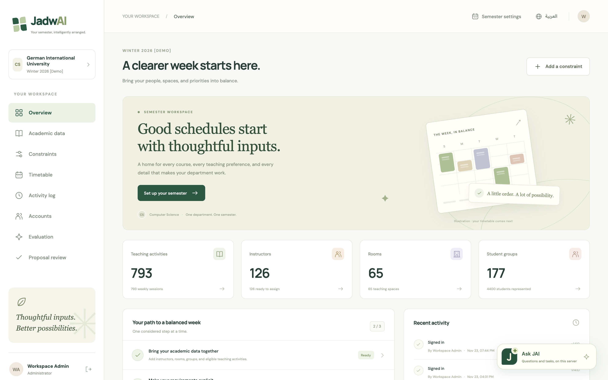
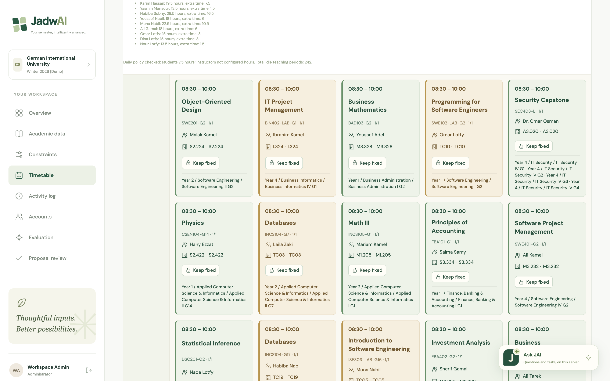
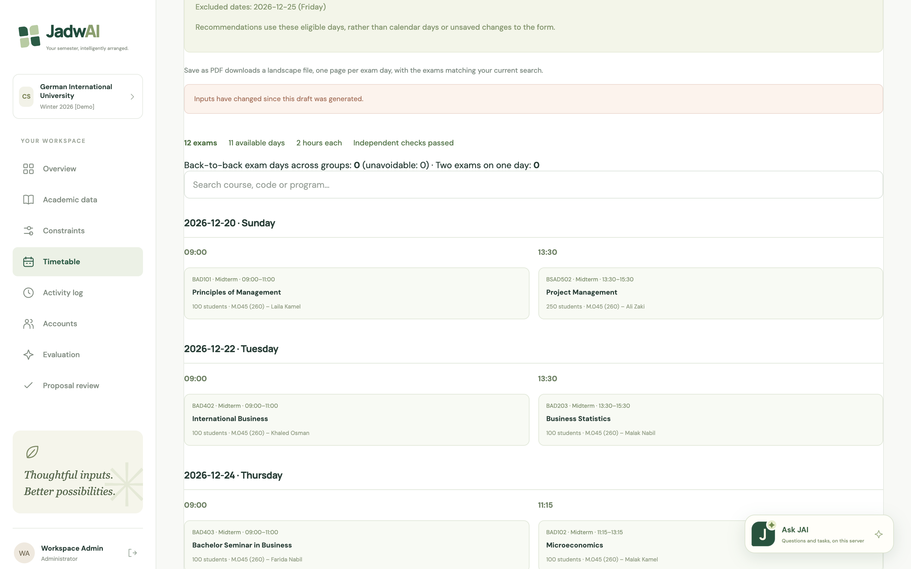
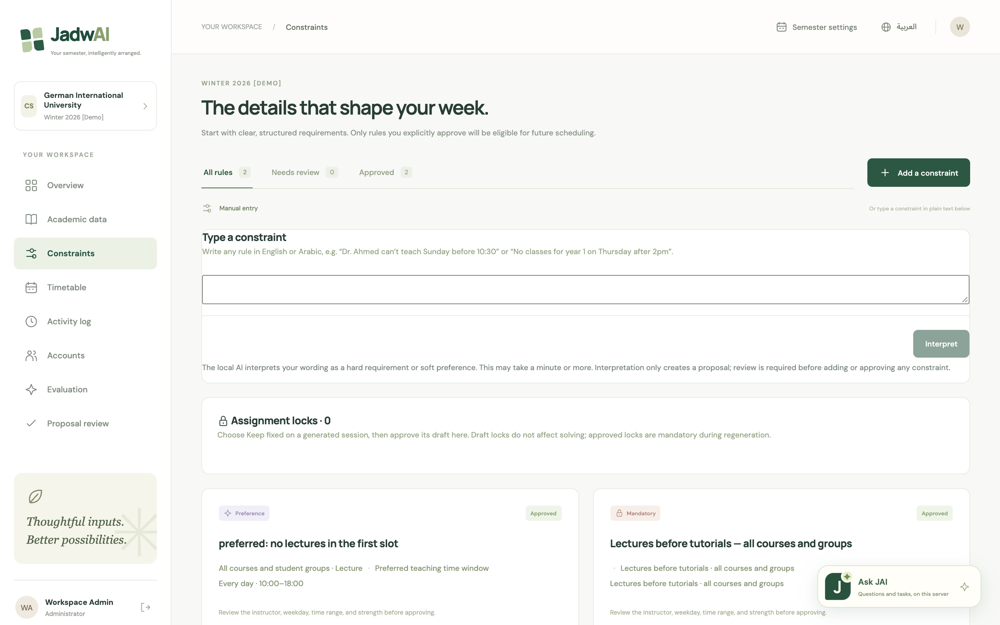
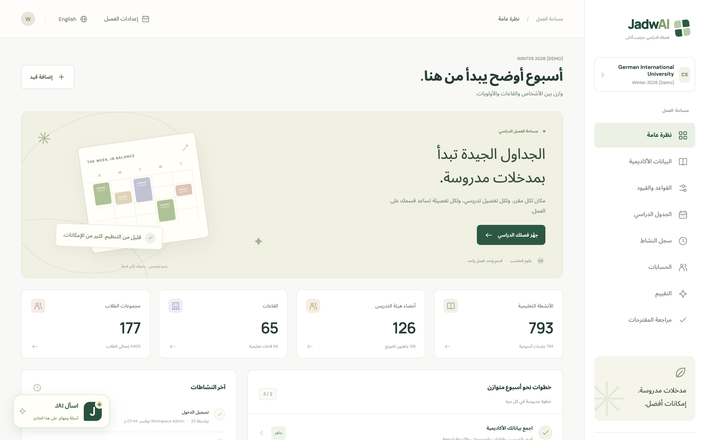

# JadwAI

**AI-assisted university timetabling, with requirements typed in English or Arabic.**

JadwAI (from *jadwal*, جدول, "timetable", plus AI) is a web application that builds weekly teaching timetables and exam timetables for a university. Administrators enter their data and rules, or type rules in plain English, formal Arabic or Egyptian Arabic. A solver then generates timetables, and an independent validator checks every one before it can be published. **JAI** (pronounced "jay"), the built-in assistant, answers questions about the timetable and prepares changes, which run only after the administrator confirms them. JAI's language model runs on the same server, so no data is sent to an outside AI service.

This repository is the prototype for a bachelor thesis, *AI-Assisted University Timetabling Through Natural-Language Constraint Extraction*. All names and records shown are demonstration data.



## What it does

- **Academic data:** instructors (doctors and teaching assistants), rooms with capacities and features, student groups (year → programme → group), courses with lectures, tutorials and labs, and CSV import.
- **Constraints:** unavailability, preferred periods, room requirements, daily limits, days off and locks. Rules are entered with forms or typed in plain language, and each is reviewed and approved before it is used.
- **Teaching timetables:** generated with Google OR-Tools CP-SAT, optimising a convenience score (fewer gaps, fewer days on campus, preferences met). Large timetables are built in parts.
- **Independent validation:** every timetable is re-checked by separate code before publication, and publication is refused if anything is violated.
- **Repair suggestions:** when the rules cannot all hold, JadwAI finds a minimal set of changes that would make a timetable possible. It never applies them automatically.
- **Exam timetables:** quizzes, midterms, second-chance midterms and finals, with exam halls, splitting of large exams and TA invigilators.
- **Publishing and portals:** students and instructors see only their own published timetable. Timetables export as PDF and CSV.
- **Two languages:** a full English and Arabic interface, with right-to-left layout.
- **JAI chat:** questions and confirmed tasks. Built-in patterns answer first, and a local model (Qwen2.5-7B via Ollama) handles the rest, using a verified guide to how JadwAI works.

| Teaching timetable | Exam timetable |
|---|---|
|  |  |
| **Constraints** | **Arabic interface** |
|  |  |

All screenshots are in [`docs/screenshots/`](docs/screenshots/).

## Documentation

| Document | Contents |
|---|---|
| [Requirements](docs/REQUIREMENTS.md) | All functional and non-functional requirements, with their current status |
| [Development notes](docs/DEVELOPMENT.md) | Detailed setup, operations and the dated development log |
| [Verification](docs/VERIFICATION.md) | How features were tested and what the evidence shows |
| [Decisions](docs/DECISIONS.md) and [Roadmap](docs/ROADMAP.md) | Scope decisions and project phases |
| [Fine-tuning results](finetuning/RESULTS.md) | How JAI's local model was fine-tuned and evaluated |
| [Thesis](thesis/) | LaTeX source and evidence scripts |

## Technology

- **Frontend:** React and TypeScript (Vite).
- **Backend:** Python 3.14 and FastAPI, with SQLAlchemy and Alembic on PostgreSQL.
- **Scheduling:** Google OR-Tools CP-SAT in a separate worker process, plus an independent validator.
- **AI:** a model served locally by Ollama (`qwen2.5:7b-instruct`, optionally fine-tuned with QLoRA; see [`finetuning/`](finetuning/)). An adapter for an external model exists but is switched off by default.

## Run it locally

Requirements: Python 3.14, Node.js 22+, and Docker with Compose. Ollama is optional; it's only needed for the chat's model answers.

```sh
bash scripts/setup.sh
bash scripts/dev.sh
```

Then open http://127.0.0.1:5180 and sign in with `JADWAI_ADMIN_EMAIL` and `JADWAI_ADMIN_PASSWORD` from the generated `.env` file. Setup creates a random password; `.env` is never committed. The API documentation is at http://127.0.0.1:8010/docs.

To use the local model, install [Ollama](https://ollama.com), run `ollama pull qwen2.5:7b-instruct`, and set `JADWAI_AI_ENABLED=true` and `JADWAI_AI_PROVIDER=local` in `.env`. On a laptop without a GPU, an answer can take several minutes.

Run all tests with:

```sh
bash scripts/check.sh
```

More detail is in the [development notes](docs/DEVELOPMENT.md).

## Repository map

| Path | Contents |
|---|---|
| `frontend/` | Web interface |
| `backend/` | API, database models, migrations, solver model, validator and assistant |
| `worker/` | Background timetable generation |
| `evaluation/` | Development corpus and scoring tools for constraint interpretation |
| `finetuning/` | Training data, training notebook, merge and evaluation tools for JAI's model |
| `thesis/` | Thesis source and evidence |
| `docs/` | Requirements, decisions, verification, screenshots |

## Status

JadwAI is a research prototype, not a production system. What is implemented and what is not is listed per requirement in [docs/REQUIREMENTS.md](docs/REQUIREMENTS.md). Measured results and their limits are in the thesis and in [docs/VERIFICATION.md](docs/VERIFICATION.md).
